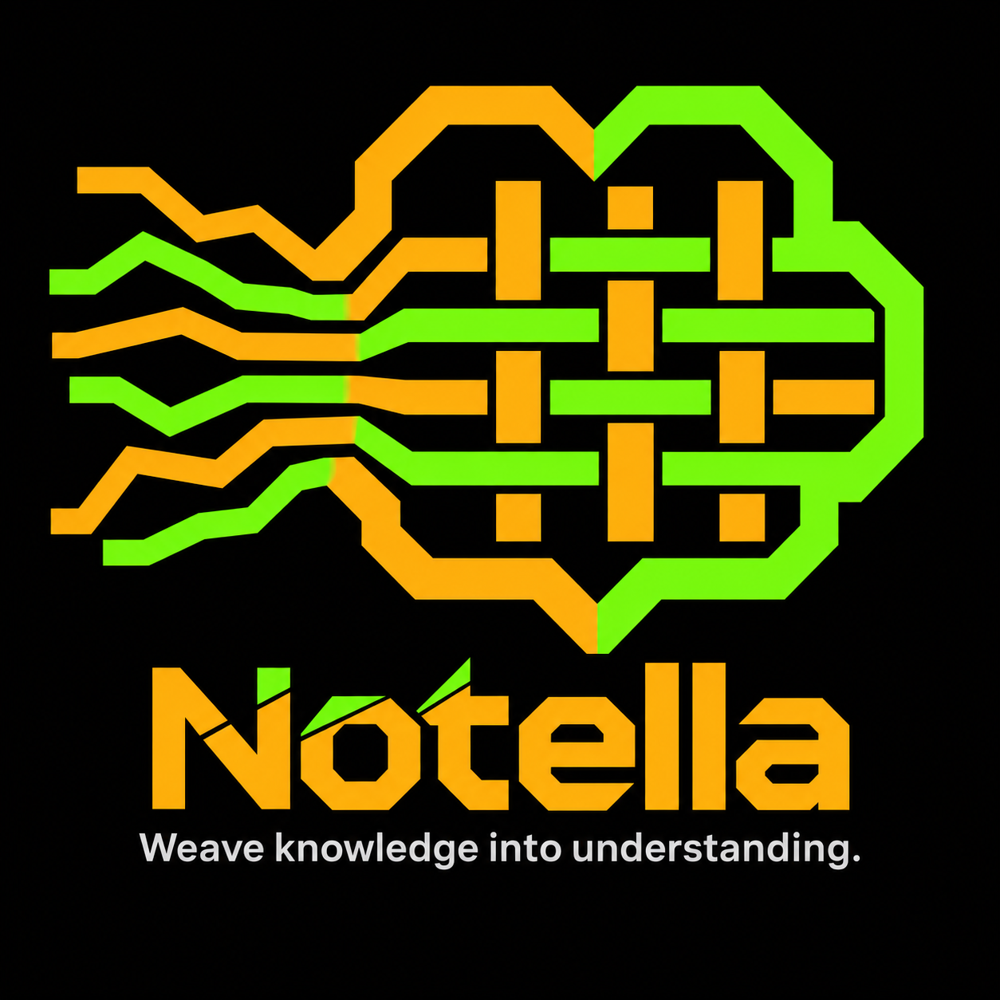
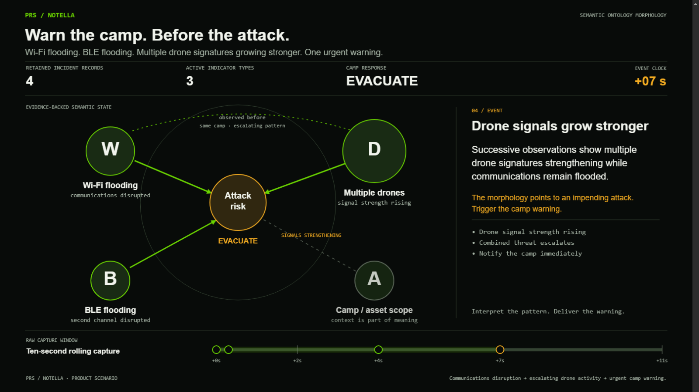

# Notella

<table>
<tr>
<td valign="top" width="52%">

**Weave knowledge into understanding.** A Project Revive Solutions technology.

### Put understanding in people's hands.

Recognizing a developing threat requires more than collecting signals. People need to understand what changed, what the evidence supports, and whether there is still time to act.

Notella exists to teach that distinction. The camp-protection scenario illustrates the intended progression from changing Wi-Fi/BLE observations and drone signatures to a protective warning. It is an authored scenario, not proof of a qualified warning system.

</td>
<td valign="top" align="center" width="48%">

<br>
<a href="https://mikevan.github.io/Notella/infographics/watch.html"></a>
<br>
<a href="https://mikevan.github.io/Notella/infographics/watch.html">▶ Watch the 58-second animation</a>
</td>
</tr>
</table>

**Learn:** [Tutorial 0: environment setup](docs/setup.md) · [Tutorial index](docs/index.md)

**Follow the AI work:** [How we use and train AI](docs/how-we-use-ai.md) · [Iteration history: successes and mistakes](docs/ai-iteration-history.md)

## How we pursue that purpose

We make the meaning, evidence relationships, and changes over time explicit before teaching a model to interpret them. Reviewed examples, reproducible experiments, and visible failures let us test understanding rather than mistake fluent output for reliable judgement. The reusable training core remains independent of this first application.

**The ontology represents the semantic model. The intended AI captures changes in that model over time (morphology) and interprets them. The trainer defines the semantic model and how it is represented as an ontology before authoring examples or adapting weights.**

Our intended approach is **Semantic Ontology Morphology–guided LoRA training**: use existing language-model capabilities to interpret an explicit system model, its evidence relationships and their evolution. The [method and node-edge reasoning](docs/semantic-ontology-morphology.md) describe the intended behavior; the [Colibri scenario workflow](docs/scenario-authoring.md) explains how a local teacher will propose new scenario branches for review. The first [scenario contract and tutorial](docs/scenarios.md) now provide versioned prefix states, graph/evidence validation, a rule baseline and seven provisional teaching branches. Neural scenario interpretation, live state maintenance and independent scenario evaluation remain unimplemented; earlier model experiments concern compact single-observation decisions. [Start with environment setup](docs/setup.md).

## What Notella provides

Notella provides a reusable Python API and a versioned local HTTP API for ontology-guided semantic LoRA training. LayerTime is its first profile, not a dependency of the core API. Version 0.1 is a working developer foundation, not a hosted service or qualified threat-detection product.

**Start with the [guided documentation and tutorials](docs/index.md).** The [first tutorial](docs/tutorial.md) runs without a GPU; the [training tutorial](docs/training.md) explains exactly when real training starts. Other applications can use `from notella import Client` or the authenticated OpenAPI description at `/v1/openapi.json`. [Start with environment setup](docs/setup.md).

## Development results

The [0.6B student diagnostic](experiments/student-v1-teacher-augmentation/RESULTS.md) completed two fresh adapters with 90 applied updates each and zero skips. Direct training matched 8/8 new numeric-variation controls and 10/10 historical development controls; adding six reviewed teacher labels matched 6/8 and 8/10. These are related synthetic cases, not scenario-morphology or field validation. The direct student is preferred for further diagnostics; a teacher benefit has not been demonstrated.

Earlier, the [v6 typed-observation experiment](experiments/warning-v6-typed-training/RESULTS.md) completed 90 applied updates and matched all ten new synthetic development controls, versus five for the matched base. It also passes 19 known-template regressions; 18 of those inputs equal normalized training inputs and are explicitly not held-out evidence. Two unsupported input specimens are deferred before generation. No phone installation or field qualification follows.

[Input/output contract tutorial](docs/input-output-contracts.md) explains payload exclusion, explicit provenance roots, output rejection without repair, and why caller assertions are not source authentication. The software suite currently has 108 passing checks. [Start with environment setup](docs/setup.md).

## Quick start

Python 3.11 or later runs the core and HTTP API without third-party dependencies. From this folder:

```powershell
python -m unittest discover -s tests -v
python -m notella demo --store data
$env:NOTELLA_API_TOKEN = python -c "import secrets; print(secrets.token_urlsafe(32))"
python -m notella serve --store data
```

The server binds to `127.0.0.1:8765`. Keep the token in your environment; authenticated endpoints require `Authorization: Bearer <token>`. `GET /health` is public. Request bodies are limited to 4 MiB. This release supports local use only; TLS, remote hosting, multiple workers, user accounts, cancellation and distributed GPU scheduling are future work.

## Python API

```python
import json
from pathlib import Path
from notella import Notella

api = Notella('data')
ontology = api.register_ontology(json.loads(Path('examples/layertime.ontology.json').read_text()))
curriculum = api.compile(ontology['id'], json.loads(Path('examples/layertime.examples.json').read_text()))
plan = api.plan(curriculum['id'], 'qwen3-4b', steps=70)
```

Concepts, directed relations, task instructions and an output contract are explicit. Teaching examples carry concepts, original family, split, source reference, permission, label author and training admission. Artifacts have immutable SHA-256 identities and are verified on retrieval. Version changes produce new artifacts. An ontology is serialized into training prompts; references alone are not claimed to teach its meaning.

The compiler rejects unknown concepts, unadmitted training sources, family/input overlap across splits and explicitly excluded evaluation prompt hashes. Exclusion hashes must use Notella's canonical JSON fingerprint of either the input string or system/user message list. Near-duplicate detection and independent source-family review still require human work. Label validity and redistribution permission are recorded assertions, not independently certified facts.

Output contracts support a documented subset of JSON Schema: type, properties, required, additionalProperties=false, items, enum, const, length/item bounds, uniqueItems, numeric bounds and description. Complex JSON Schema features such as `$ref`, oneOf and pattern are unsupported. This is not an OWL/RDF reasoner or a general JSON Schema implementation.

## HTTP API v1

| Method | Endpoint | JSON request |
|---|---|---|
| POST | `/v1/ontologies` | Ontology object; see example |
| POST | `/v1/curricula` | `ontologyId`, `examples`, optional `excludedPromptHashes` |
| POST | `/v1/plans` | `curriculumId`, `baseModel`, optional `steps`, `rank`, `learningRate` |
| POST | `/v1/jobs` | `planId`; requires a configured training backend |
| GET | `/v1/jobs/{id}` | Job state and local process/result information |
| POST | `/v1/evaluations` | `curriculumId`, `predictions` mapping example IDs to JSON objects, optional `split` |
| GET | `/v1/{ontologies,curricula,plans,evaluations}/{id}` | Retrieve and verify an artifact |

Creation returns `{id, artifact}`, except jobs, which return their job state. Missing artifacts return 404, invalid requests 400, missing/wrong tokens 401. Ontology and curriculum creation are idempotent for identical canonical content. Job submission intentionally creates a new run; an exclusive GPU lock prevents competing jobs within the same store.

```powershell
$headers = @{ Authorization = "Bearer $env:NOTELLA_API_TOKEN" }
$ontology = Invoke-RestMethod http://127.0.0.1:8765/v1/ontologies -Method Post -Headers $headers -ContentType application/json -Body (Get-Content examples/layertime.ontology.json -Raw)
$payload = @{ ontologyId=$ontology.id; examples=(Get-Content examples/layertime.examples.json -Raw | ConvertFrom-Json) } | ConvertTo-Json -Depth 40
$curriculum = Invoke-RestMethod http://127.0.0.1:8765/v1/curricula -Method Post -Headers $headers -ContentType application/json -Body $payload
```

## Real local training

The core remains dependency-free. Training requires an existing CUDA environment with the pinned packages recorded in `training-requirements.txt`, a licensed local base model, and the included training engine. No weights are downloaded by the API. The engine is reused from the tested LayerTime implementation with a Notella-specific curriculum verifier; its provenance is recorded in `training_engine/PROVENANCE.json`.

```powershell
python -m notella serve --store data --engine training_engine --python C:\workspace\TUltra-Project\LayerTime\tools\ai-training\.venv\Scripts\python.exe --model qwen3-4b=C:\workspace\TUltra-Project\LayerTime\tools\ai-training\models\qwen3-4b-instruct-2507
```

Only model aliases configured by the server owner can be used. API callers cannot supply executable names, commands, model paths or output paths. Jobs export hash-checked datasets, preserve separate validation/test splits, and run the trainer without a shell. The trainer uses training and validation only. Models and Python environments can live anywhere; the LayerTime paths above are local examples, not required locations.

One server process per store is supported. Keep the server running while training: it records child completion and releases the lock. If the server exits unexpectedly, the child may continue; inspect `jobs/<id>/job.json`, its PID, adapter manifests and `gpu.lock` before manually recovering. Never delete a lock merely because the server restarted. The lock does not coordinate other applications using the GPU.

## Evaluation and limitations

`evaluate()` measures schema validity, coverage and exact target agreement on a held-out split. It explicitly does **not** measure semantic accuracy. Interpretations need criterion-based review tied to exact generated outputs, plus independent field evidence before product qualification. All artifacts and models remain `releaseEligible=false`.

The initial camp profile contains 30 training variants from ten synthetic families, two validation families and three test families. These are policy-teaching examples, not 35 observed incidents. The 120-second timing window and posture levels are proposed project policy, not calibrated attack probabilities. No model can establish a looming attack merely because two events occur close together.

See [temporal evidence design](docs/temporal-evidence.md) and [development results](docs/results.md).

## Local teacher experiment

The optional teacher Python API and [Tutorial 10](docs/teachers.md) connect a loopback Colibri/OpenAI-compatible server to ontology-scoped candidate drafting, exact request/response receipts and explicit review boundaries. It does not admit candidates or start student training. [Start with environment setup](docs/setup.md).

The [first live teacher results](experiments/colibri-teacher-v1/RESULTS.md) are negative for automatic label generation: the configured untuned 35B teacher matched 5/10 existing synthetic development controls, versus the unchanged trained 4B adapter's prior 10/10 on the same case IDs. All five wrong replies were rejected by evidence checks. Its first free-form draft also failed review. These are different model/runtime conditions, not an engine benchmark or independent field accuracy measurement. That first experiment admitted no examples; no compression, training speed or phone improvement was established. Core/provider checks at that checkpoint: 81 passing.

## Smaller student diagnostic

A [constrained teacher task](experiments/colibri-teacher-v2-constrained/RESULTS.md) produced six policy-consistent decisions, which received explicit agent review before admission to a bounded augmentation experiment. Two fresh local 0.6B adapters completed 90 applied updates each, zero skips, with finite weights. The direct ontology-guided student matched 8/8 new numeric-variation controls and 10/10 historical development controls; the teacher-augmented student matched 6/8 and 8/10. The direct student is preferred for further diagnostics. These are related synthetic cases, not independent field validation, and this one-seed added-data comparison does not isolate a causal teacher effect. No phone export or deployment occurred. [Full results, receipts and limits](experiments/student-v1-teacher-augmentation/RESULTS.md). Software checks at that checkpoint: 108 passing.

## Semantic morphology comparison and streaming reference

The [completed matched 4B scenario comparison](experiments/scenario-model-v3/RESULTS.md) improved schema validity (3/10 to 8/10) but not criticality agreement (3/10 for both). The adapter remains unsuitable for deployment. Exact evidence, semantic failure analysis and a curriculum correction plan are preserved with the results. [Tutorial 15](docs/semantic-failure-diagnosis.md) explains the diagnosis. [Start with environment setup](docs/setup.md).

[Rolling windows](docs/rolling-windows.md) and [focused monitoring](docs/focused-monitoring.md) implement and demonstrate broad ten-second monitoring advancing every second, explicit focused incidents, retained evidence and continued background collection. The synthetic replay does not call an AI. These are runtime primitives, separate from the full-prefix model comparison; delta-model and phone integration remain unqualified. Checks at that checkpoint: 138 core tests and 4 optional training-loss tests passing.

## Curriculum repair and warning continuity

The [controlled curriculum rerun](experiments/scenario-model-v4/RESULTS.md) holds the model/training settings and twenty-row/eighty-update budget fixed. Known criticality agreement improves from 3/10 to 6/10; fresh agreement is 5/8 versus base 4/8. Retraction/scope errors and repetitive incomplete output remain. [Interpretation and next target](experiments/scenario-model-v4/INTERPRETATION.md). The adapter remains unqualified for deployment.

[Tutorial 16](docs/warning-continuity.md) demonstrates configurable output budgets, bounded retries, retained validated assessments/focused incidents, and warning-state callbacks before inference. It uses a simulated backend, with real-provider/phone delivery integration still required. Token exhaustion must not silently clear or discard warnings. Current core checks: 154 passing; the unchanged optional training-loss checks passed separately. [Start with environment setup](docs/setup.md).

## Failure checkpoint and next direction

Read the [consolidated failure report](docs/morphology-failure-report.md), [five root-cause hypotheses](experiments/retraction-diagnosis-v1/HYPOTHESES.md), and [teacher-to-student roadmap](docs/teacher-student-roadmap.md). The v5 curriculum reduced repetition and improved known decision agreement but regressed full-state correctness and underperformed the base on the fresh decision controls. Root cause is unresolved; no candidate is deployment-ready.

The [checkpoint archive](archive/morphology-v1/README.md) preserves runtime documents, training records, outputs and historical source snapshots with original paths and hashes. Binary weights and optimizer files remain local and are inventoried separately. Publication uses the reviewed checkpoint statement and explicit file manifest.

[Explore the scrollable development infographic](docs/infographics/semantic-morphology-evolution.html): initial approach, semantic-model transformation, measured failures and gains, and the proposed teacher/student path.
